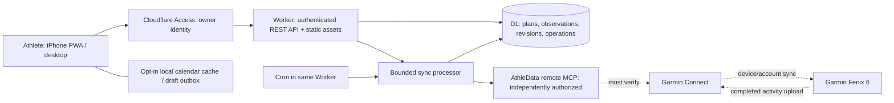

# ENDURANCE OS — architecture

Decision date: 2026-10-28 (Europe/Oslo). Status: architecture proposal ready for review, not an implemented or deployed application. The latest architecture-only specification supersedes the earlier build request.

## Scope and evidence

A private application for one athlete: Norwegian UI, Oslo calendar dates, iPhone PWA and desktop. The calendar must work without AthleData. No social features, subscriptions, public registration, paid AI dependency, or invented athlete measurements.

The checkout contained only Git metadata, an unborn `work` branch, and no source, manifests, lockfiles, or agent instructions. This task creates documentation only. Provider observations and research sources are recorded in [ATHLEDATA_INTEGRATION.md](ATHLEDATA_INTEGRATION.md). No authenticated AthleData capability or Garmin roundtrip is verified.

## Selected architecture

One TypeScript repository, one Cloudflare Worker with static assets, one D1 database per environment, and a scheduled handler in the same Worker. React is a client-rendered SPA built with Vite and the official Cloudflare Vite plugin. No SSR is needed for this private application. All browser requests use the same origin and `/api/v1`.



The browser never calls MCP or Garmin directly. D1 is authoritative for planned workouts created here. Garmin/AthleData are sources for observed activity and recovery data. Local plans, recorded activities, and derived analytics remain distinct.

## Decisions and tradeoffs

| Decision | Reason and consequence |
| --- | --- |
| React + TypeScript + Vite + official Cloudflare plugin | One browser build and a real local `workerd` backend. Verify compatible stable versions in Phase 1 and commit the lockfile; architecture does not pin untested combinations. |
| Tailwind + shadcn/ui + Lucide | Own accessible components, customize a small set; avoid importing an entire UI suite. |
| TanStack Query, React Hook Form, Zod | Server cache, local form state, shared versioned validation. No global Redux store. Zod validates domain DTOs, not arbitrary MCP JSON Schema. |
| Recharts, lazy loaded | Adequate mobile trends and intervals; accessible table alternatives. Avoid sending full activity time series with dashboard data. |
| Native D1 prepared SQL and numbered migrations | Transparent indexes and transaction semantics; no ORM required for a small normalized schema. Typed repository functions isolate SQL. |
| Official MCP TypeScript client | Registry currently reports `@modelcontextprotocol/client` 2.4.0 with workerd exports. Real Workers transport, schema validation and provider interoperability still require tests. Never select an old SDK from a copied example by default. |
| Cloudflare Access + app sessions | Outsource owner authentication and MFA to the configured identity provider. Worker verifies Access JWT; opaque app sessions enable CSRF, OAuth binding and revocation. No password storage or public signup. Access enrollment and pricing eligibility are deployment prerequisites. |
| D1 durable outbox + Cron | Low volume does not justify Queues/Durable Objects initially. At-least-once dispatch requires explicit leases, ambiguity handling and bounded work. Add Queues only if measured backlog/limits justify it; queues do not solve external exactly-once writes. |
| Summaries/laps in D1; no raw FIT archive initially | Avoid database bloat. FIT parsing is optional until a real provider requires it and Workers CPU/memory are measured. R2 is a later justified option for large raw files, not a baseline service. |
| Rule-based suggestions | Explainable and free of AI subscription. Approvals are version-checked; no automated plan mutation. |

## Component boundaries and proposed files

These paths are a future layout, not files that exist today.

```text
src/
  app/                 router, providers, authenticated shell
  components/ui/       reviewed shadcn components
  features/            home, calendar, workouts, analysis, settings, adaptation
  lib/                 api client, query keys, date/number formatting
  offline/             IndexedDB, draft outbox, version/conflict handling
  styles/              tokens, responsive layout, safe areas
shared/
  contracts/           REST schemas and DTOs (no credentials)
  domain/              workout AST, durations, units, matching, analytics, rules
worker/
  index.ts             fetch and scheduled entry points
  middleware/          Access JWT, sessions, CSRF, limits, error translation
  routes/              thin REST handlers
  services/            transactional application actions
  repositories/        parameterized D1 queries
  integrations/athledata/ oauth, MCP transport, discovery, capability adapters
  sync/                outbox, leases, reconciliation, imports, matching
  analytics/           projections, completeness, recomputation
migrations/            numbered D1 SQL, added incrementally
tests/                 unit, workerd integration, e2e, sanitized provider contracts
public/                manifest and static icons
```

Domain code is pure and independent of React, D1 and MCP. Routes perform validation and authorization, services coordinate persistence, and adapters translate provider schemas. Provider field names never leak into calendar domain types. Schema versions and adapter versions are recorded with outputs.

## Complete lifecycle and failures

| Step | Boundary / required evidence | Failure and response |
| --- | --- | --- |
| Create structured workout | Valid AST and revision saved atomically with idempotency result | Invalid input rejected; stale edits return conflict; local draft retained. |
| Request Garmin delivery | Owner intent, capability map, current revision, durable operation | No permission or untranslatable target: keep local plan and explain blocker. |
| Invoke AthleData | Independent OAuth grant, MCP negotiation, verified tool schema | Refresh/consent errors block; uncertain delivery enters reconciliation, never blind create retry. |
| Garmin Connect accepts | External workout ID, separate schedule ID if provided, read-back if available | Tool success is not evidence of watch delivery. Replacement IDs are tracked historically. |
| Fenix 6 receives | Connected Garmin account, supported sport/step representation, device sync | Device offline, incompatible workout or scheduling unsupported: show honest delivery level. |
| Record and upload | Athlete completes workout and Garmin uploads it | Delayed/offline upload is expected; imported absence is not a failed workout. |
| AthleData exposes activity | Availability/retention, stable identifiers, pagination/detail | Backfill overlap, retries, partial status and coverage windows. |
| Import/match | Canonical identity, metric provenance, confidence and manual review | Near duplicates quarantined; no guessing on equal candidates. |
| Compare and recompute | Separate planned revision and observed activity; versioned projections | Missing data stays unknown; corrections invalidate affected local dates onward. |
| Suggest adjustment | Sufficient fresh inputs, unlocked future plan, explicit approval | Fixed mode generates no proposals; stale approval returns conflict. |

The early roundtrip gate in [IMPLEMENTATION_PLAN.md](IMPLEMENTATION_PLAN.md) is essential: no design can promise watch delivery without real provider and device evidence.

## Calendar and time semantics

Use canonical sport keys `running`, `cycling`, `xc_skiing`, `skierg`, `swimming`, `strength`, `recovery`, `mobility`. UI labels are Norwegian. Scheduled calendar dates are `YYYY-MM-DD` in `Europe/Oslo`; a date-only workout has no fabricated start instant. Optional local start time plus IANA zone is converted explicitly to a UTC instant. Reject nonexistent DST times and require an explicit offset choice for repeated times. Recurrence expands local dates, not repeated 24-hour UTC increments.

All audit/import/token timestamps use UTC epoch milliseconds in storage and RFC 3339 UTC strings at API boundaries. Activity start/end preserve provider offset/zone when supplied; derive athlete calendar date in Oslo without truncating UTC. Weeks start Monday. Sleep attaches to wake-up date while retaining its UTC interval. Profile age, event dates and thresholds are not inferred from old prompts: prior user-supplied values may be offered for confirmation, never seeded as current observations.

## Analytics contract

Every metric carries source, observed interval/date, retrieved time, unit, quality/completeness, method version for calculated values, and `planned | observed | calculated`. Null means unknown; zero means a known zero. Staleness is separate from missingness. Summaries include coverage and exclude suspected duplicate records until resolved.

| Metric | Input and calculation |
| --- | --- |
| Planned hours | Sum revision-specific known durations for scheduled non-deleted plans; report count with unknown duration. |
| Completed hours/distance | Sum canonical activities once; moving and elapsed duration remain distinct. Weekly totals sum moving duration where available, else elapsed with an explicit fallback label. |
| Consistency | Completed planned sessions / eligible planned sessions in elapsed days; exclude cancelled/future, show unplanned completions separately. Version the definition. |
| Cycling power/intervals | Provider watts/laps with quality, no inference from speed. Weighted averages require durations; unknown samples remain gaps. |
| Session-RPE load | Observed elapsed session minutes (including recovery) × athlete RPE (0–10), recorded as `srpe_au_v1`. Missing RPE or elapsed duration means no such load; do not silently substitute moving time. |
| Provider training load | Store scale, producer and algorithm separately. Garmin load is not TSS or sRPE. Show the provider series on its own axis. |
| CTL / ATL / TSB | Only for a selected, consistently defined load series with adequate history/coverage. For locally implemented TSS-like series: `CTL[d]=CTL[d-1]+(L[d]-CTL[d-1])/42`, ATL uses 7; morning `TSB[d]=CTL[d-1]-ATL[d-1]`. Record initialization and coefficients. These are model values, not medical readiness or interchangeable with provider fitness scores. |
| HRV / resting HR / sleep | Observed source metrics with protocol: e.g. nightly RMSSD vs SDNN never pooled. Rolling 7-day median against prior 28-day baseline, ≥5/7 and ≥21/28 eligible nights. Preserve sleep stage uncertainty. |
| Goals | Sport-specific distances/durations and test results; event target dates nullable; no predicted race time without an explicit validated model. |

CTL/ATL rule: require at least 84 consecutive covered days of the selected scale for the standard view; seed at zero at the start of that history, mark initialization and warm-up uncertainty. A covered rest day is zero. A day with unknown import coverage or a completed activity lacking that scale is incomplete, not zero; stop the continuous series at that gap, show unavailable thereafter until repaired. Historical curve values may remain visible with their coverage. No cross-scale fill. Provider CTL stays a separate observed metric with its disclosed/unknown method.

Adaptive rule v1: fresh subjective fatigue ≥8/10 or soreness ≥8/10 may suggest replacing the next unlocked hard session with recovery; at least two eligible adverse signals (low comparable HRV below personal median minus 1.5 MAD, resting HR ≥7 bpm over baseline, sleep <6 hours) may suggest reducing duration 20%. These are configurable conservative heuristics, not clinical thresholds. Subjective inputs must be from today, nightly observations from the last 36 hours, and imports successful within 6 hours; thresholds are versioned settings. Zero-MAD or insufficient baselines abstain. Missing/baseline-insufficient inputs abstain, not improve a score. Upcoming event/taper and availability constraints bound changes. Store reasons, inputs, rule version, expiry (at most 24 hours or workout start, whichever comes first) and affected revisions. Highest-priority rule wins per workout; no stacking reductions. No injury diagnosis, invented readiness score or automatic changes. [API_DESIGN.md](API_DESIGN.md) defines approval.

## Performance and cost budgets

Calendar queries use athlete/date indexes and a maximum 93-day span. Analytics allow up to 366 days with daily aggregates; activity details and charts load on demand. Frontend initial JS target ≤200 KiB gzip excluding deferred charts, mobile LCP target <2.5 s on a representative midrange device; measure rather than claim.

Baseline Cron proposal: every 15 minutes, 96 invocations/day; cheap due-check when idle. Imports normally every 60 minutes, owner-triggered sync when needed; queued writes run at the next tick or a bounded authenticated request after persistence. Maximum five external calls and 20-second wall budget per dispatch, concurrency one per integration, resumable pages. Actual quotas/timeouts can require lower budgets. No continuously open MCP connection or background polling in an inactive PWA. Respect backoff and provider limits.

D1 official limits retrieved on 2026-10-28: free maximum database size 500 MB, paid 10 GB; max row/string/BLOB 2 MB; max 100 bound parameters/query. These are not price guarantees. Track database size, rows read/written, Worker CPU, external calls, backlog age. No raw 1 Hz streams in D1; store summaries and bounded laps. Prefer retention/configuration changes before adding infrastructure. Cloudflare Access plan eligibility, Workers CPU, AthleData charges/limits and custom-domain costs must be checked before launch. Free tiers are a target, not a guarantee.

Production, staging and local bindings/credentials are separate. Read replication is not needed initially. Use primary-consistent reads for sync claims and mutations; if replicas are introduced, use the D1 Sessions API/bookmarks. Cron UTC timing only controls due-checks; athlete-facing scheduling uses Oslo.

## Cross-document authority

- [DATABASE_SCHEMA.md](DATABASE_SCHEMA.md): storage, invariants and migration slices.
- [ATHLEDATA_INTEGRATION.md](ATHLEDATA_INTEGRATION.md): evidence and OAuth/MCP gates.
- [GARMIN_SYNC_DESIGN.md](GARMIN_SYNC_DESIGN.md): state machines, identity and reconciliation.
- [API_DESIGN.md](API_DESIGN.md): public application contracts.
- [UI_UX_PLAN.md](UI_UX_PLAN.md): screens, accessibility, offline behavior.
- [SECURITY.md](SECURITY.md): authentication, secrets and deletion.
- [IMPLEMENTATION_PLAN.md](IMPLEMENTATION_PLAN.md): sequence and acceptance tests.
- [DEVELOPMENT.md](DEVELOPMENT.md): actual progress and blockers.
- [AGENTS.md](AGENTS.md): future-session instructions.
