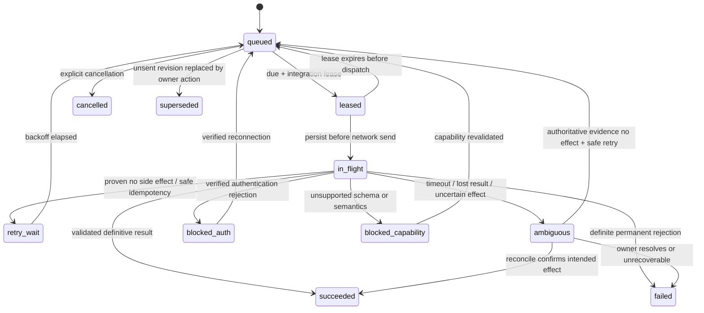

# Garmin delivery, activity import and reconciliation

This subsystem depends on verified AthleData capabilities, not direct Garmin passwords or unofficial scraping. See [ATHLEDATA_INTEGRATION.md](ATHLEDATA_INTEGRATION.md). All tool names below describe internal intentions until discovery confirms actual provider schemas.

## Authority and identity

ENDURANCE OS owns plans created here; provider activities are separate observations. A local workout UUID never changes. Each edit creates an immutable revision. Imported arbitrary Garmin workouts are read-only external references unless provider ownership/editing support is verified.

Identity chain: local `workout.id` → exact `workout_revisions.revision` → `sync_operations.id` → `external_workout_refs` generation → external workout ID and optional distinct schedule ID. The provider account namespace is part of every external mapping. A returned workout ID is not automatically a Garmin activity ID, schedule ID or device-delivery receipt.

User-facing status has two axes:

- Plan: planned, partial, completed, cancelled; derived from plan state and confirmed activity links.
- Delivery: `Ikke synkronisert`, `Venter`, `Synkroniserer`, `Sendt til Garmin`, `Oppdatert lokalt`, `Feilet`, `Må avklares`, `Krever tilkobling`, `Ikke støttet`.

“På klokken” is shown only with actual device evidence, usually owner confirmation in the initial integration test. Tool success alone means at most provider acceptance. Every status includes the last successful sent revision and timestamp, so a new local edit cannot remain falsely marked current.

## Operation state machine

No terminal result inferred from HTTP status alone. Parse MCP errors, tool `isError`, and validated result fields. Preserve request/operation IDs and redacted results. Unknown fields or missing result ID after a possible create are ambiguous.

## Durable dispatch algorithm

1. Owner mutation with API idempotency key is validated and committed to D1. Sending is explicit; saving/editing alone never implies a remote write. “Lagre og send” requests both as one local transaction. Disconnected saves stay useful.
2. Outbox payload pins workout revision, normalized payload hash, adapter version, capability schema hash, intended external ID/generation and schedule intent. Browser sees 202 plus operation ID only after durable commit.
3. Processor atomically claims a due operation and per-integration lease/fence. A single connection dispatches one remote operation at a time; other invocations observe the lease. Proposed call timeout 15 s, dispatch budget 20 s and lease 90 s, subject to provider testing. These bounds reduce overlap but do not guarantee remote cancellation.
4. Refresh credentials under the same lease if needed. Recheck connection status and operation prerequisites. Persist `in_flight` and `dispatched_at` before sending. A crash after that marker is treated as ambiguous, even if the request might never have left.
5. Invoke reviewed adapter. Use provider idempotency support only if verified. A locally stored idempotency key does not deduplicate provider calls.
6. On definitive success, atomically update mapping/history under the lease fence. Persist raw external IDs in redacted result metadata, not full health payloads. If response arrives after lease loss, do not mark success with a stale fence; record a quarantined outcome for reconciliation using operation identity.
7. Release lease. Durable pending work is resumed by Cron; `waitUntil` is only a best-effort latency improvement, never the durability mechanism.

An expired in-flight write blocks newer writes to the same workout and, conservatively, the integration until reconciled. The recovery worker may read provider state under a new reconciliation lease. Fencing protects local commits; it cannot prevent a stale request from completing remotely. Do not claim exactly-once delivery. An operator/owner decision is necessary if provider evidence cannot settle an uncertain side effect.

Retry policy: read requests use exponential backoff with full jitter (base 30 s, cap 6 h), max 8 attempts, respect longer `Retry-After`. Definitively rejected safe writes use max 5 retries over 24 h. HTTP 5xx, connection resets and transport timeouts on writes are ambiguous unless provider contract guarantees no effect. A 429 is retryable only where no side effect is guaranteed. Authentication denial pauses for reconnect; repeated 401 never causes an infinite refresh loop. Manual retry reuses the operation/key, and is disabled for ambiguous creates until reconciliation. History records every attempt.

## Create, update, move and delete

| Action | Required behavior |
| --- | --- |
| Create | Validate sport/step/target support. Translate full pinned definition, include stable client marker if a verified field exists. Persist returned ID. If scheduling is separate, enqueue a dependent schedule operation (`reschedule` kind with initial schedule intent); status remains partially delivered until schedule succeeds. |
| Update, same ID | Address active known external ID; send complete revised definition if contract requires. Advance mapped revision/generation, retain prior mapping history. No generic fallback to create on update failure. |
| Update, replacement ID | Store returned new ID as a new generation; old mapping becomes superseded/unresolved depending on provider guarantees. Verify new schedule binding and whether old object/schedule still exists. Old-ID removal is a separate approved cleanup only after read-back; do not delete based on assumption. |
| Move | New local revision preserves structure with new Oslo date/optional time. Use supported schedule update; if create/delete is the only mechanism, explicitly surface replacement semantics and wait for owner confirmation of that operation. Old date is cleared only with confirmed provider outcome. |
| Delete | Soft-delete/cancel locally, retain IDs/revisions. Request separately whether to remove owned Garmin workout/schedule. Persist delete intent before local hiding. Verify what provider deletes: schedule only vs library object. Do not delete completed activities or arbitrary external workouts. |
| Duplicate | Create a new local UUID/revision and no external mapping. Copy targets/description, not completions, lock state, notes or provider IDs. Owner must explicitly send the duplicate. |

If v4 is queued and unsent when v5 is explicitly sent, mark v4 superseded and queue v5. If v4 is in flight, let its outcome resolve; v5 depends on that result and uses its returned active ID at safe dispatch, while preserving v5's immutable definition. A reschedule/update arriving during ambiguous state waits. Device completed data always links to the delivered revision when known, not silently to the latest edited revision.

Locked workouts reject adaptive mutations. Manual edits require explicit unlock first; unlock is versioned/audited. Already sent workouts can be locked without altering Garmin. Cancellation/deletion does not erase an unresolved external operation.

## Reconciliation decision table

| Available evidence | Action |
| --- | --- |
| Provider idempotency returns prior result | Record that definitive result; update mapping. |
| Stable client marker lookup finds exactly one matching object/revision | Confirm mapping and payload/schedule; terminal success only if intended effect is verified. |
| Known ID exists with verified intended revision/hash | Update/reschedule can resolve success. |
| Delete returns documented already-absent result or authoritative not-found in correct account | Resolve deletion success, preserve tombstone. |
| Lookup shows old state but provider request may still run | Wait; absence/old state from an eventually consistent list is not definitive no-effect evidence. |
| Multiple candidates, inaccessible lookup or no correlation field | `ambiguous`, explain uncertainty, offer owner comparison/manual resolution. Do not guess by title and retry create. |

Manual reconciliation records inspected external identifiers, rationale, resolution and time. It never accepts arbitrary external ID ownership without verification. Connection/account changes pause existing operations until mappings are verified in their original account.

## Completed activity import

Incremental list/detail tools must be verified for pagination, ordering, time filters, IDs, unit semantics and update/delete behavior. Webhooks are not assumed. Auto-import is opt-in. Default hourly bounded imports; manual sync is debounced and coalesced with an already active import.

Use provider cursor if supported; otherwise bounded time windows ordered by start time plus external ID. Re-read a 72-hour overlap on each pass, a 30-day reconciliation window weekly, and offer owner-requested historical backfill in resumable 30-day pages. These are proposed budgets, to tune to measured retention/quotas. No finite overlap guarantees arbitrarily late uploads; manual backfill remains available. Cursor advances only after each page/chunk is persisted. A full paginated pass must finish before its window becomes covered.

Import summary first; nullable details are marked partial and fetched later. Timestamp/source normalization and schema limits apply before storage. Upserts compare provider version or payload hash; newer observations append activity revisions. Keep original sources and field-level provenance. Provider temporary omission is not a deletion. Explicit provider tombstones are recorded, and deletion/inclusion policy is surfaced to owner rather than silently destroying history.

Canonical dedup order:

1. Same integration/account/external ID → update its existing source.
2. Same verified upstream namespace + upstream Garmin activity ID + same verified athlete account → attach a second source to the same canonical activity.
3. Otherwise propose a duplicate candidate using sport, UTC start, duration, distance and known device/file evidence; never use date/title alone as a unique key. Mark the new uncertain record `suspected_duplicate`, exclude it from aggregate totals and surface a pending-data indicator. Athlete can confirm merge or keep distinct.
4. Merge preserves all source references/revisions, selects preferred values with provenance, and redirects active links after conflict review. Canonical totals count only one record. A later split is possible from retained evidence.

Intervals/laps import independently of whole activity. Never interpret absent laps as zero intervals. Download URLs, if ever needed for FIT, require reviewed host allowlists, bounded size/content type, no provider-token forwarding to arbitrary hosts and a tested parser. GPS/raw FIT retention is off by default.

## Matching planned and actual

First use a provider-supplied planned-workout relationship only after its meaning/account namespace is verified. Resolve historical replacement IDs through all external refs and select the actual sent revision. Exact ID still requires compatible sport/date and no contradictory link; anomalies go to review. An external activity ID alone is not a planned-workout relation.

Fallback candidates are unlinked noncancelled plans in the same Oslo date; include adjacent local dates only for plausible midnight/time-zone boundary cases. Require compatible sport and plausible duration. Proposed deterministic score v1:

| Feature | Weight | Definition |
| --- | --- | --- |
| Same Oslo date | 0.20 | Same date=1; adjacent justified boundary=0.5; otherwise excluded. |
| Sport | 0.15 | Exact sport=1; approved compatible subtype=0.8; incompatible excluded. |
| Start-time proximity | 0.25 | `max(0,1-abs(delta_minutes)/180)` if planned time known. |
| Duration similarity | 0.20 | `max(0,1-abs(actual-planned)/max(actual,planned))`, comparable duration type only. |
| Structure | 0.20 | Verified lap/work/recovery sequence similarity, excluding warm-up variation; unknown=0. |

Missing features contribute zero, not renormalized confidence. Store component scores and missing evidence. This is an explainable heuristic score, not a statistical probability. Auto-link only at score ≥0.90, margin ≥0.15 over the next candidate, at least three independent measured features including start time, and no duplicate/partial-data/account conflict. Otherwise show suggestions; with no planned time the maximum fallback score is 0.75, intentionally requiring manual confirmation. Calibrate on owner-reviewed examples before enabling fallback auto-linking. Do not lower thresholds just to demonstrate a passing roundtrip.

Manual link/unlink is versioned/audited and may override the heuristic with a reason. Partial sessions remain partial. Matching does not mutate the original plan. Completed sessions use their linked revision in planned-versus-actual analysis. One-to-one active linking is v1's explicit boundary; split/multisport sessions need manual handling until allocation semantics are designed.

## Tests required

- Contract fixtures for real discovered schemas, unit conversion, unsupported sports, FTP targets and nested repeats.
- Same-ID and new-ID updates, old/new schedule cleanup, deletion of already-absent owned objects, wrong-account protection.
- Crash before send, after send, after response before persistence; overlapping Cron/manual invocations; expired lease and stale late response; refresh rotation response loss.
- Double-click/replayed API request, offline replay, same idempotency key with different payload, update while create pending.
- Out-of-order/duplicate pages, partial metrics, late upload beyond overlap, source correction and suspected cross-provider duplicate.
- Two similar sessions on one date, date-only plans, DST changes, midnight sessions, exact-ID contradicting sport, manual unlink/relink.
- Real athlete-approved Fenix 6 roundtrip including Connect visibility, physical device arrival, completed upload, import, comparison and analytics exactly once. Mock tests are necessary but cannot satisfy this last acceptance gate.
