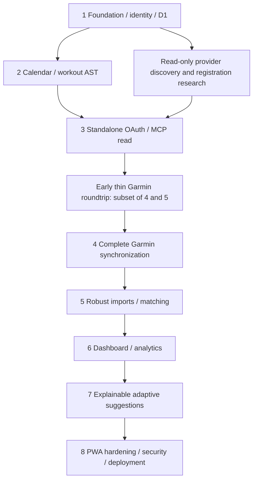

# Dependency-aware implementation roadmap

This file specifies future work. No phase has been implemented. The architecture task ends with documentation; a new implementation instruction is required before scaffolding, dependencies, application code or deployment.

## Order and gates

Accessibility, security, responsive layout and tests start in Phase 1; Phase 8 verifies and hardens them. Local calendar work can proceed while provider access is blocked. Provider gates block claims of real Garmin functionality, not independent local planning. Perform read-only discovery/registration research early to avoid investing in an unsupported provider path.

Every phase ends with changed modules, migration IDs, executed commands/results, and remaining external blockers recorded in DEVELOPMENT.md. Fake-provider tests are labeled contract simulations and cannot satisfy live acceptance. Do not make routine CI require the athlete's live account or mutate Garmin.

## Phase 1 — foundation, identity, database, design system

**Objectives:** reproducible Vite/React/TypeScript project with official Cloudflare plugin; single Worker REST entry and local D1; Norwegian responsive shell; verified owner/session/CSRF boundary; empty-state UX. No athlete data seeded as reality.

**Dependencies:** existing checkout, compatible stable package versions, Node 24 toolchain (currently 24.19.0 installed; verify stable patch/security updates before pinning), npm lockfile. Live auth needs Cloudflare Access application/team/audience/owner subject, approved staging origin and MFA identity. Local development can use isolated loopback mock identity with deployment-time fail-closed checks.

**Files/modules:** package.json + lockfile, Node pin, tsconfig, vite.config, Wrangler configuration with explicit local/staging/production bindings, src/app and components/ui, styles/tokens, shared/contracts/errors, worker/index, middleware/auth/csrf/errors, repositories/sessions, test configuration and CI workflow. No MCP dependency needed yet.

**Database:** `0001_identity`: owner, sessions, profile, preferences, rate-limit buckets, audit and mutation guards. Migration test verifies FK and guard rollback semantics. OAuth transactions arrive in Phase 3. Secure random values only in ignored local configuration/secret bindings.

**API:** health, session bootstrap/read/logout, profile and preferences read/update; exact Origin and versioned mutation handling. UI uses real local Worker API/D1, not embedded fake success.

**Acceptance:** fresh `npm ci` and local migration work; Vite invokes real workerd; one profile edit persists after restart; anonymous/wrong-owner/expired sessions cannot read profile; CSRF rejection works; no auth bypass in production config; five Norwegian routes with accessible empty states and mobile/desktop nav. Live Access claim and standalone Safari login checks are mandatory before production readiness, but can remain clearly blocked during local development.

**Tests:** unit schemas/date/units; workerd session lifecycle/owner/CSRF/atomic rollback tests; UI keyboard/empty-state e2e; `typecheck`, `lint`, unit/integration, build and browser smoke. Test bootstrap cookie flags and no personal data in assets.

**Risks:** Access PWA redirect behavior, SDK/plugin compatibility, production bypass misconfiguration, unverified auth-time for destructive actions. Diagnose setup separately from product failures; record external prerequisites without fake credentials.

## Phase 2 — calendar and structured workouts

**Objectives:** fully useful disconnected planning: daily/weekly/monthly, CRUD, move/duplicate, multiple sessions/day, templates, finite recurrence, blocks, notes and locks. Reusable canonical AST and duration calculations; calendar accessible without provider connection.

**Dependencies:** Phase 1 persisted identity/contracts; date/DST policies. No provider dependency to save plans.

**Files/modules:** shared/domain/workout, dates, duration and units; src/features/calendar/workouts; editor forms/repeat blocks; worker/routes/workouts/templates/recurrences/goals/blocks; services/plan-mutations; repositories/planning.

**Database:** `0002_planning`, including immutable revision steps/targets, zone/availability sets, goals/blocks, templates/recurrences/exceptions and API idempotency. Deferred revision-head FK and unique occurrence tests are release gates.

**API:** calendar, workouts including revisions/lock/move/duplicate, templates, goals, blocks, availability/zones, recurrence preview/materialize. Every mutation has version/idempotency semantics and bounded input.

**Acceptance:** all eight sports, nested repeats, explicit final recovery behavior, exact/estimated/unknown duration, complete intensity targets, no silent data loss. Reload preserves data; stale simultaneous edit gets 409; locked workout rejects changes until explicit unlock; recurrence replay creates no duplicates and cannot recreate removed occurrence. Provider send controls show unavailable, never fake success.

**Tests:** AST property/edge cases, distance without pace, target ranges/FTP snapshots, repeated/invalid local times at Oslo DST, month/year boundaries, one/multiple daily sessions, duplicate IDs excluded, revision history, two-tab conflicts, recurrence exceptions, rollback on invalid child. Browser CRUD and keyboard-only move flow.

**Risks:** broad editor scope, recurrence complexity and accidental automatic target conversion. Limit recurrence to documented weekly finite rules; preserve unknown durations.

## Phase 3 — independent AthleData OAuth and MCP

**Objectives:** real standalone account connection, discovery, least-privilege consent, token lifecycle, capability map and one real read. No dependence on a ChatGPT connector.

**Dependencies:** A1 network access; A2 provider-permitted client registration and callback; configured Worker encryption keys; owner Access/session. Complete a Worker compatibility spike before committing to SDK imports. Recheck current stable official client release (research saw 2.4.0).

**Files/modules:** integrations/athledata/oauth, discovery, transport, token-store, schema/capability registry; settings connection UI; security fixtures; Worker-compatible JSON Schema validator.

**Database:** `0003_integrations`: oauth_transactions, connections/leases, external refs, operations/history. Read-back operations available for the early slice. Token encryption and rotation migration/version fields tested.

**API:** connect/callback/disconnect, integration status, read-only discovery/diagnostics surfaced safely. Callback never returns raw credentials. No browser-exposed arbitrary tool invocation.

**Acceptance:** verified metadata and exact callback, S256 flow, granted scopes and issuer/resource binding, encrypted token persistence, one authenticated tools/list plus read executed in workerd and staging. Test refresh if supported; unsupported capability remains explicit. Disconnect prevents calls and truthfully reports revocation outcome.

**Tests:** token crypto/AAD, metadata SSRF/redirect validation, state/session replay, unsupported S256, code-exchange response loss, rotated refresh race/loss, opaque token handling, MCP init/session expiry/list pagination/errors, schema drift disabling adapter, expired Access during callback. Synthetic provider tests plus a separate owner-authorized live account test.

**Risks:** partner-only registration, absent read/write scopes or tools, Worker transport limitations, auth endpoint allowlists and provider terms/cost. If blocked, stop only dependent integration work and retain working local calendar.

## Earliest vertical slice — after Phase 3, before full Phase 4/5 breadth

Implement the smallest Phase 4 create/outbox/mapping path and Phase 5 single-activity import/link path, with minimal needed 0004 tables. Do not bypass durability, auth or uncertainty handling for the test. Enable only verified operations, guard behind an owner-only diagnostic workflow, and disable automatic retries when no safe correlation exists.

1. Owner chooses one short easy timed workout in a verified supported sport. Save its UUID/revision, not an invented workout history.
2. Send once through real backend OAuth/MCP. Store operation and returned workout/schedule IDs; read back if supported. Record actual schema/SDK/protocol versions and timestamps.
3. Confirm presence and scheduled date in Garmin Connect. Owner syncs Fenix 6 and confirms actual device appearance. No unattended agent can assert this physical step.
4. Owner completes the small session and lets Garmin upload. Poll/import under bounded budget; preserve stable IDs and observations.
5. Link with verified relationship ID or manual review. Show saved plan revision against recorded duration/distance/laps when present. Reimport/reload and prove exactly one canonical activity and unchanged totals.
6. Verify one harmless revision update/reschedule only when owner explicitly chooses it; record same/replacement IDs and check duplicates. Clean up only this test's owned planned object when requested; never delete the completed activity for convenience.

Pass evidence: D1 plan/revision/operation/mapping/activity/link, redacted provider request/result metadata, owner-confirmed Connect/watch steps, observed planned-versus-actual UI and dedup replay. If any boundary is unavailable, record it as failed/blocked and do not advertise the end-to-end feature. This test is not performed during the architecture task.

## Phase 4 — Garmin writes and reconciliation

**Objectives:** create/update/reschedule/delete of owned workouts, replacement-ID lineage, durable retry/reconciliation UI, verified supported sport/target translation.

**Dependencies:** Phase 3, early slice, A5/A6 contract evidence. Fenix 6 capability matrix required; unsupported combinations are blocked explicitly.

**Files/modules:** integrations/athledata/workout-adapter; sync/outbox/dispatcher/reconcile/leases; scheduled handler; settings history, SyncBadge and resolution UI.

**Database:** strengthen 0003 constraints as needed through new append-only migration; existing external refs and sync history hold lifecycle evidence. Never edit a previously applied migration to hide incompatibility.

**API:** workout Garmin command, operations status/retry/reconcile; optional send alongside save. Payload cannot accept arbitrary tool names/provider credentials.

**Acceptance:** full saved revision delivered, returned replacement ID becomes active atomically, old IDs remain traceable, schedule moved correctly, deletes only owned objects. Timeout after possible side effect becomes ambiguous; user cannot blind retry. Queued stale revision may supersede; in-flight revision is reconciled before dependent update.

**Tests:** state-machine transitions and every crash point, duplicate requests, manual/Cron races, lease fencing/late response, provider rate limits/5xx/timeouts, partial schedule success, replacement ID with retained old schedule, unsupported translation and schema drift. Real provider contract tests remain separate from CI.

**Risks:** absence of read-back or upstream idempotency prevents safe automated recovery. Do not paper over this with local keys or “exactly once” claims.

## Phase 5 — activity import, recovery observations and matching

**Objectives:** resumable incremental list/detail imports, provenance, canonical deduplication, late updates, recovery facts, confident/manual matching and planned-actual comparison.

**Dependencies:** Phase 3 read contracts, mapping lineage from Phase 4, completed live roundtrip evidence where possible.

**Files/modules:** sync/import/cursors/coverage/dedup/matching; provider activity/recovery adapters; repositories/activities; src/features/workouts/activity-detail/match-review; shared/domain/matching.

**Database:** `0004_activities` and observed portion of `0005_analytics_recovery`; activity sources/revisions/laps/links/feedback, dedup candidates, import cursors/coverage, recovery/wellness/provider metrics. Add schema incrementally if early slice already applied part of this work.

**API:** activity list/detail/feedback/match/link/unlink/dedup, recovery and wellness; manual import and bounded backfill.

**Acceptance:** reimport is idempotent; a cross-provider verified Garmin ID yields one canonical activity; uncertain duplicates wait for review; delayed summary/detail never overwrites known values with a false zero. Matching score/evidence visible; ambiguous same-day sessions require owner choice. Observed and planned records remain independent; manual feedback survives provider correction.

**Tests:** DST/midnight/time zone conversion, missing elapsed vs moving durations, source-ID collisions across accounts, reversed pages/cursor restart, incomplete windows, stable-ID relation to superseded workout ID, two same-day sessions, late update beyond overlap, split sessions handled explicitly, rollback before cursor commit.

**Risks:** retention limits, inaccessible FIT/laps, unknown units/HRV method, unreliable planned activity IDs. Add raw FIT parsing/storage only after actual need and CPU/storage evidence; no speculative R2.

## Phase 6 — dashboard and analytics

**Objectives:** truthful home metrics, sport volume, planned vs actual, interval comparison, goals, compatible load/recovery trends with missing/stale/partial states.

**Dependencies:** Phase 5 reliable provenance and coverage; verified load scales. Metric availability gates apply even with attractive empty charts.

**Files/modules:** shared/domain/analytics; worker/analytics/projections/recompute; dashboard and analytics routes; src/features/home/analysis, lazy charts, accessible tables.

**Database:** remaining `0005_analytics_recovery`: training_load_metrics, daily_analytics, analytics_jobs. Immutable source facts remain authoritative. Derived series store algorithm version and input watermark.

**API:** dashboard, analytics date/sport/scale; activity comparisons and coverage/status.

**Acceptance:** totals equal independent fixture calculations with no duplicate counting; known rest vs unknown coverage handled distinctly; never mix Garmin load/TSS/sRPE. CTL/ATL/TSB only with qualifying series/history and documented initialization; rest-day decay matches formula. HRV compares compatible methods and sufficient baseline; stale inputs labeled. 7/28/90/365/custom ranges remain fast.

**Tests:** analytical known sequences, delayed corrections invalidating subsequent CTL, unknown-day gap, initialization horizon, aggregate inclusion, elapsed/moving fallback, planned unknown durations, HRV protocol mismatch, NaN/missing safeguards, indexed query plans and mobile bundle/interaction measurements.

**Risks:** scientifically overstated readiness, scale confusion, expensive long-history recompute. Use bounded resumable projection jobs and conservative availability rules.

## Phase 7 — deterministic adaptive recommendations

**Objectives:** fixed/adaptive modes, explainable conservative proposals from real data; explicit approval/rejection with immutable audit. No paid AI API.

**Dependencies:** Phase 6 eligible fresh metrics; goals, availability, zones, subjective inputs, lock/version semantics.

**Files/modules:** shared/domain/adaptation/rules and eligibility; worker/services/adaptations; UI proposal comparison and settings mode.

**Database:** `0006_adaptation`, proposals/changes with snapshots, reason codes, expected versions/revisions and expiry.

**API:** list/generate/approve/reject; change mode via preferences. Approval requires current adaptive mode, unlocked future workouts, fresh proposal inputs and versions. Garmin delivery remains separately authorized.

**Acceptance:** fixed mode generates/applies nothing; insufficient inputs abstain; no locked/completed workout altered; competing rules do not stack excessive reductions; approval changes all intended targets atomically or none. Explain every proposal with values/times/source. No generated injury diagnosis or hidden score.

**Tests:** table-driven rule thresholds and missing baselines, expiry, changed input watermark, lock added after proposal, profile/goal/availability update, double approval, concurrent manual change and all-or-none batch rollback.

**Risks:** heuristics overreacting, inadequate baseline, stale recommendations. Keep initial rules limited and adjustable; record owner feedback, not claimed clinical effectiveness.

## Phase 8 — PWA, security verification and release

**Objectives:** tested iPhone installation/offline drafts, robust updates, privacy controls, backups/restore, measured performance and reviewed Cloudflare deployment.

**Dependencies:** all required behavior above, actual Cloudflare bindings/secrets/Access settings, verified provider registration and quotas. Deployment requires a separate authorized release action; this roadmap itself authorizes no deployment.

**Files/modules:** manifest/icons/service worker, src/offline stores/outbox/conflicts; privacy/export/delete services; CI and deployment checks; release/restore runbooks and secret/config examples without values.

**Database:** `0007_privacy`; bounded cleanup retention; migration/backup consistency checks. No credentials in exports. Persist only opted-in minimal offline calendar in browser.

**API:** privacy jobs/export chunks/deletion, polished auth/reconnect flows. No endpoint caches private data in service worker.

**Acceptance:** real iPhone Safari browser/installed modes pass login, safe areas, offline cold start and draft conflict recovery; SW upgrade preserves drafts; revoked sessions fail online; logout clears device cache. All security tests in SECURITY.md pass, staging restore cannot replay old remote operations, migration upgrade/downgrade mitigation documented. Budgets measured on representative device and account; cost/limits checked. No unresolved critical auth/integrity issue at release.

**Tests:** full e2e, accessibility/VoiceOver, CSP/auth bypass, SSRF, export/privacy interruption, browser storage eviction, offline schema upgrade, multiple tabs, real physical watch roundtrip, staged migration and restore, performance and provider call-count tests. Keep passed/failed/skipped/unrun separate.

**Risks:** iOS storage eviction/background limits, Access standalone behavior, provider permission or cost changes, free-tier CPU limits. Do not equate a successful build with production readiness.

## Exact next Codex prompt for Phase 1

> Implement Phase 1 of ENDURANCE OS as specified in IMPLEMENTATION_PLAN.md. First read AGENTS.md, ARCHITECTURE.md, DATABASE_SCHEMA.md, API_DESIGN.md, UI_UX_PLAN.md, SECURITY.md and DEVELOPMENT.md. Use the existing /workspace/Endurance-os checkout and preserve these architecture decisions. Create the React/TypeScript/Vite application using the official Cloudflare Vite plugin, a Worker API, local D1 migrations, Norwegian responsive navigation and accessible empty states. Implement the owner identity boundary, secure app sessions, CSRF and versioned profile/preferences persistence, with an explicitly isolated loopback-only development identity and fail-closed production configuration. Verify compatible stable dependencies and commit a reproducible lockfile. Run local migrations, meaningful workerd authentication/persistence tests, type checks, lint, build and browser smoke tests. Do not implement AthleData/Garmin yet, invent athlete data, create cloud resources or deploy. Record actual results and any live Access prerequisites in DEVELOPMENT.md. Continue until the local Phase 1 acceptance criteria pass or a concrete external prerequisite blocks further independent work.
